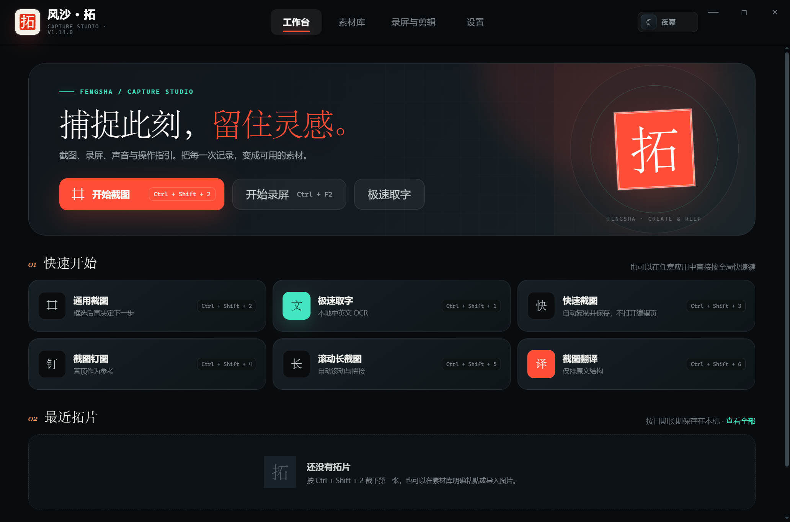
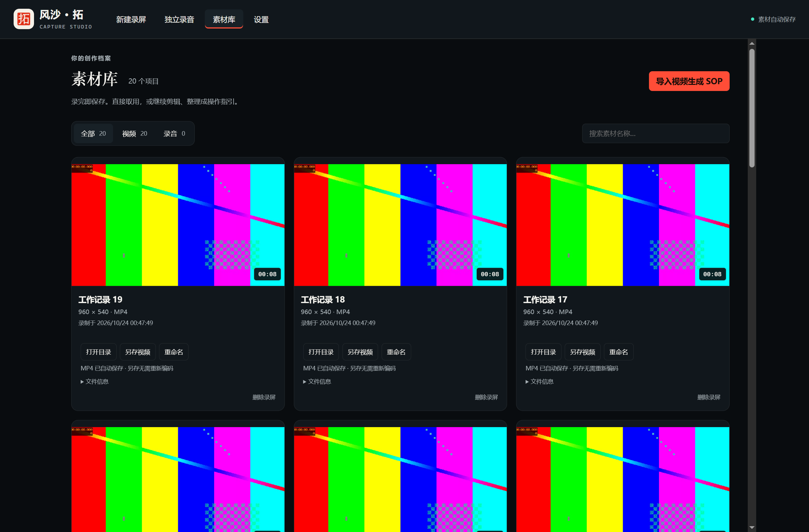
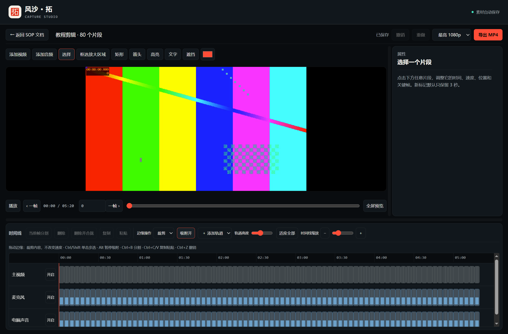
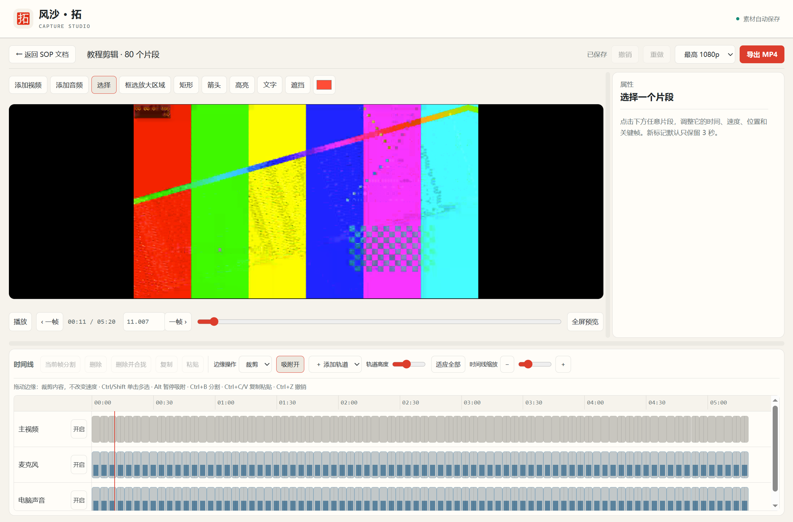

# 风沙 · 拓 1.14.0 体验与性能验收

本次检查针对 Windows 实际运行程序，聚焦日常截图 → 录制 → 取用素材 → 剪辑 → SOP 的既有流程。未把 AI 模型质量或未复现的所有卡顿问题宣称为已经解决。

## 定位到的问题与处理

| 问题 | 原因或证据 | 本次处理 |
|---|---|---|
| 素材多时后台频繁忙碌 | 20 条已完成素材静置约 3 秒仍读取 80 次状态 | 已完成后停止轮询；进行中的保存继续更新；窗口恢复焦点时刷新 |
| 播放占用界面线程过多 | 每次高刷新率屏幕的绘制循环重新遍历和渲染轨道；重复生成波形 | 缓存静态轨道、波形和时长；播放界面按录制帧率更新 |
| 分割后跨片段反复重新加载 | 同一源文件每个片段使用不同播放器标识 | 复用同轨同素材播放器；变化时更新位置、速度和音量 |
| 首页过早加载全部剪辑代码 | 启动入口同时引用 SOP 和时间线 | 路由按需加载；主入口 JS 从 364.81 KB 降至 263.34 KB |
| 截图辅助启动失败 | 系统 Windows PowerShell 的运行时 C# 临时编译失败 | 在构建阶段内存编译 .NET Framework 程序集，运行时直接加载；无需给用户安装新运行时 |
| 操作区域拥挤、风格不统一 | 录屏与截图是两套页面，路径和说明长驻；最小窗口下工具栏挤压预览 | 统一风沙品牌和双主题、折叠文件详情、添加素材搜索分类、小窗口工具栏滚动 |

## 性能对照

同一台机器、同一套隔离素材：20 个项目，240 个轨道片段，播放 11 秒；不访问真实用户素材，不调用 AI。

| 指标 | 优化前 | 优化后 |
|---|---:|---:|
| 素材库静置约 3 秒的重复状态读取 | 80 | 0 |
| 播放 11 秒期间界面线程累计工作时间 | 9.411609 秒 | 1.957457 秒 |
| 跨片段移除的媒体元素数 | 9 | 0 |
| 动画帧间隔 P95 | 8.4 ms | 8.5 ms |
| 超过 50 ms 的界面长任务 | 0 | 0 |

界面线程工作量减少约 79%。原用例本身的帧间隔已经较好，因此这里证明的是减少不必要计算和媒体重建，而不是把整体播放帧率提高了 79%。真实复杂项目、硬件、输入视频编码和 AI 服务延迟仍会影响体验。

可复现命令：`npm run build` 后运行 `npm run smoke:experience`。脚本生成隔离测试项目和实际界面截图。最小 940 × 660 窗口已检查：无页面横向溢出，预览、播放控制、轨道均可访问。没有删除用户素材。

## 实际流程检查

| 流程 | 结果 |
|---|---|
| 启动、深浅主题、快捷键、截图/OCR、复制/保存、图库、钉图、长截图状态浮层 | 开发版完整 E2E 通过；安装版完整流程运行完成 |
| 截图预览与成图像素一致、剪贴板辅助状态 | 全分辨率无损核验通过，辅助进程启动正常 |
| 素材搜索/清空搜索/分类、录制入口/设置、SOP/剪辑往返、全屏 | 实际 Electron 界面通过 |
| 多选、关联音频拖动、裁剪、变速、复制粘贴、撤销、区域缩放 | 实际鼠标键盘操作通过；导出图像中的区域放大进入/退出核验通过 |
| 箭头八方向、起终点、旋转；点击输入文字、方向/大小；聚光高亮 | 实际画面操作和输出通过，CLI 修改与界面撤销通过 |
| MP3、MP4 自动保存、暂停/继续、音轨、名称与日期、另存 | 实际 WASAPI/WGC/FFmpeg 链路通过；并发另存不重新编码 |
| 窗口缩放、黑屏提示、录制中切换窗口/全屏/区域、窗口关闭、声音重连 | 安装目录中的程序回归通过；保持同一项目，黑屏期间声音继续，失效窗口明确拒绝 |
| 类型与逻辑 | TypeScript 检查通过；32 个测试文件、162 项单元测试通过 |

测试时发现本机 Windows 输出处于静音。只为声音回录验收临时恢复低音量，结束后已恢复原音量和静音状态。此设备的系统声音回录受 Windows 输出静音和音量影响；录制时应确认电平有变化。

本次未调用真实付费 AI、未向飞书发送文档、未复现真实飞书会议的所有窗口切换。相关配置保持原样；不能把本地通过等同于所有外部服务和会议场景通过。

## 界面截图

以下均来自实际程序。素材和时间线画面使用合成测试视频，不包含用户视频内容。

### 首页

### 素材库

### 剪辑工作区

## 安装核验

已覆盖安装至原有 `ta-windows` 目录，文件版本 1.14.0.0；桌面快捷方式继续使用“拓 Ta”，描述更新为“风沙 · 拓”。安装前后 639 个配置、索引和资料文件的 SHA-256 未变，安装后的 app.asar、截图辅助程序集和录制程序与已验证构建一致。

安装包 SHA-256：`FFC05280025728E5893A1B611813C23E3FEDFFD9F35E6BB8EC3F1E8BD32384B6`。
